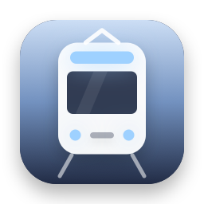
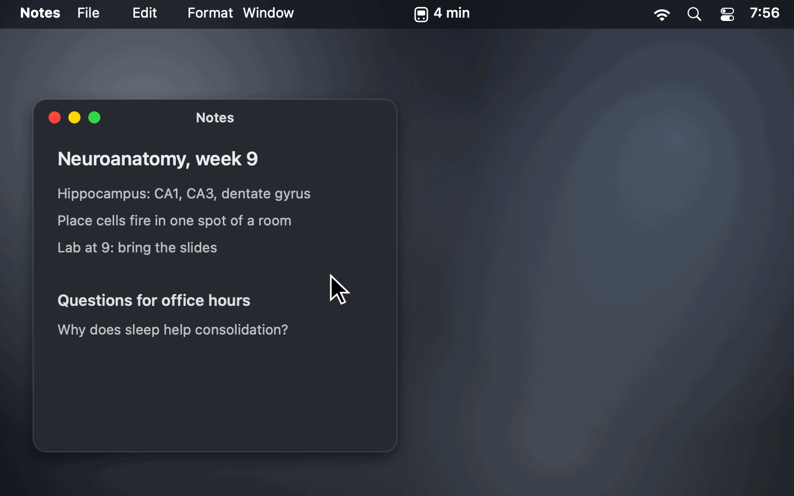
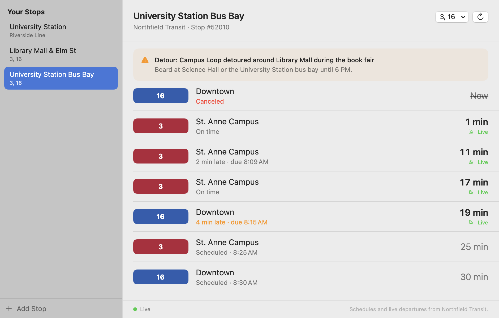

<p align="center">
  
</p>

<h1 align="center">Next Departures</h1>

<p align="center">
  <b>Your stop's next bus and train, live, in the menu bar.</b><br>
  A free, open-source menu bar app for the stops you use: the next departures, live where the agency's feed has them and from the timetable otherwise, plus service alerts. It starts with Minneapolis and Saint Paul, campus buses included, and works with any agency that publishes GTFS-realtime.
</p>

<p align="center">
  <a href="https://github.com/stanczykwyatt/next-departures/releases/latest/download/Next-Departures.zip"><b>Download for Mac</b></a>
  &nbsp;·&nbsp;
  <a href="https://stanczykwyatt.github.io/next-departures/">Website</a>
  &nbsp;·&nbsp;
  <a href="https://github.com/users/stanczykwyatt/projects/1">Roadmap</a>
  &nbsp;·&nbsp;
  <a href="https://github.com/stanczykwyatt/next-departures/discussions">Discussions</a>
</p>

<p align="center">
  <a href="https://github.com/stanczykwyatt/next-departures/actions/workflows/ci.yml"></a>
  <a href="https://github.com/stanczykwyatt/next-departures/releases/latest"></a>
  
  
  
  
  <a href="LICENSE"></a>
</p>

<p align="center">
  
</p>

---

Checking when your bus leaves usually means picking up your phone, unlocking it, finding the app, waiting for it to load and tapping through to your stop. If you're at your Mac, the answer could just be there.

Next Departures puts it in the menu bar. Pick the stops you use, like the station by your dorm and the bus stop outside class, and click the icon to see their next departures. Times come from the agency's live feed where it has them, with how late or early each ride is running, and from the timetable otherwise, clearly marked. Canceled rides, skipped stops and service alerts for your stops and routes show up right there too. Turn on **Show Next Departure in Menu Bar** and your first stop's countdown sits next to the icon.

It comes ready for Metro Transit in Minneapolis and Saint Paul, including the METRO Green and Blue Lines and the University of Minnesota's campus buses. Any other agency that publishes its schedule and GTFS-realtime feeds works too: paste their addresses. The [Mobility Database](https://mobilitydatabase.org) lists over a thousand live feeds.

It's careful with your privacy. It only connects to the transit feeds you use, only while you're looking at the menu or the window, and sends nothing about you: no account, no location, no analytics. It's open source, so you can check exactly what it does.

If it gets you to the stop on time, [starring the repo](https://github.com/stanczykwyatt/next-departures/stargazers) helps other people find it.

<picture>
  <source media="(prefers-color-scheme: dark)" srcset="docs/screenshot-dark.png">
  
</picture>

## Features

- **The next departures from each of your stops,** with the route in its own color, where it's headed, and how many minutes until it leaves.
- **Live where the feed has it.** Each ride says whether it's on time, running late or early, or just from the timetable. Delays further up the line carry down to your stop, as the GTFS-realtime spec describes.
- **Canceled rides and skipped stops,** struck through, so you don't wait for a bus that isn't coming.
- **Service alerts** for your stops, the routes that call there, and the whole agency: detours, closed stops, elevator outages.
- **Both directions at once.** Stops with the same name across the street, or a station's two platforms, are one stop to pick. Filter any stop to the routes you take.
- **A departure board window,** big and easy to read, with alerts at the top.
- **The countdown in the menu bar,** if you turn it on.
- **Find stops by name or sign number,** or pick a route to see all its stops.
- **Any GTFS-realtime feed.** Paste an agency's schedule zip and its live trip updates and alerts.
- **A command line tool,** `next-departures`, for scripts, a terminal prompt or Shortcuts.
- **Polite to the agency's servers.** The live feed is checked every 30 seconds only while the menu or the window is open, less often after errors, and never in the background. The schedule is checked once a day, and only downloaded again when it changes.
- **Free,** with no account, subscription, tracking or dependencies.

### What it can't do

- **No trip planning.** It shows what leaves from stops you pick, not how to get from A to B. Your maps app is better at that.
- **Live data is only as good as the agency's.** If a feed has no prediction for a ride, it's shown from the timetable and marked "Scheduled". If a feed stops updating for five minutes, everything falls back to the timetable.
- **No widget yet.** A WidgetKit widget needs a signed app extension, which comes with a Developer ID signature. It's on the [roadmap](https://github.com/users/stanczykwyatt/projects/1).
- **Frequency-based schedules** (`frequencies.txt`, used by some agencies for "every 10 minutes" service) aren't read yet. Live times for those trips still show.
- **Feeds that need an API key in a header** aren't supported yet. Keys in the address itself work.

## Install

1. [Download **Next-Departures.zip**](https://github.com/stanczykwyatt/next-departures/releases/latest/download/Next-Departures.zip) and unzip it.
2. Move **Next Departures** to your Applications folder and open it.
3. Pick **Metro Transit**, or add your agency's feed, click **Download Schedule**, and find your stop.

It turns on Open at Login the first time it runs, like most menu bar apps; switch it off in the menu.

> **About the security warning:** The first time you open Next Departures, macOS may say Apple couldn't verify that it's free of malware. It shows up because the app isn't notarized yet: Apple charges developers $99 a year for that, and this project hasn't paid the fee. The code is fully open source, so you can read every line or build the app yourself. To open it, go to **System Settings → Privacy & Security** and click **Open Anyway**.

> **Can't see the icon?** On a MacBook with a camera notch, menu bar icons that don't fit are hidden behind it. Hold ⌘ and drag the icon to the right, or quit a menu bar app you don't need.

### Build from source

You need macOS 14 or later and Swift 6, which comes with Xcode 16 or the Command Line Tools.

```bash
git clone https://github.com/stanczykwyatt/next-departures.git
cd next-departures
scripts/build-app.sh
open "build/Next Departures.app"
```

That also builds the command line tool as `build/next-departures`.

## How to use it

| To | Do this |
|---|---|
| See your next departures | Click the menu bar icon |
| Add a stop | Menu → Choose Stops… (⌘,), then Add Stop, and type part of its name or its sign number |
| See every stop on a route | In the stop picker, choose the route instead of typing |
| Only show some routes at a stop | Open the stop's board, then choose the routes in the menu at the top |
| See a stop's full board and alerts | Click the stop's name in the menu |
| Check right now | Menu → Refresh Now (⌘R) |
| Put the countdown in the menu bar | Menu → Show Next Departure in Menu Bar |
| Use another agency | Choose Stops… → Add Stop → Add a Feed…, and paste its addresses |
| Reorder or remove stops | Right-click a stop in the window |
| Stop it opening at login | Menu → turn off Open at Login |

### Adding another agency

You need the addresses of its GTFS schedule, a `.zip` file, and optionally its GTFS-realtime **trip updates** and **service alerts**, usually `.pb` files. Agencies list them on a developer or open data page, and the [Mobility Database](https://mobilitydatabase.org) catalogs them by city. Next Departures only accepts `https` addresses on the internet, and only ever connects to the addresses you add. Check the agency's terms of use: most ask for nothing more than credit, which the app shows next to its data.

### The command line tool

```bash
next-departures stops east bank                  # find a stop
next-departures departures 56042                 # the next departures from stop #56042
next-departures departures 56042 --json          # the same, for scripts
next-departures alerts 56042                     # alerts for that stop
next-departures departures 1234 --schedule https://agency.example.org/gtfs.zip \
  --trip-updates https://agency.example.org/TripUpdates.pb
```

`next-departures --help` lists every option. It keeps schedules in `~/Library/Caches/next-departures`, apart from the app's.

## Privacy and security

Next Departures is built so it *can't* do more than fetch your transit feeds, not just so it promises not to.

- **Only your feeds.** The only hosts it ever connects to are the ones in the feeds you use: `svc.metrotransit.org` for Metro Transit, and whatever addresses you add. A feed can't redirect it anywhere else, and it refuses addresses that point at your own Mac or local network.
- **Nothing about you is sent.** No account, no location, no analytics, no crash reports. Requests carry no cookies and nothing that identifies you or your Mac: just the file being asked for and the app's name. Which stops you picked never leaves your Mac; the app downloads the agency's whole schedule and live feed and picks out your stops itself.
- **Only while you're looking.** The live feed is fetched while the menu or the window is open, and never in the background. Once it's five minutes old, everything goes back to the timetable.
- **App Sandbox with one entitlement:** outgoing network connections. No access to your files, contacts, location, camera or microphone. CI checks every build for this.
- **Built to read untrusted data.** The zip, CSV and protocol buffer readers are written for this app, check every length and offset, and are fuzz tested with damaged and random input.
- **No dependencies.** Every line that runs is in this repository.

Check the app's permissions yourself with `codesign -d --entitlements - "/Applications/Next Departures.app"`. The full details are in [SECURITY.md](SECURITY.md).

## Transit data

Schedules, live departures and alerts come from each agency's own published feeds, and are fetched by your Mac directly from the agency. Next Departures has no server of its own, and nothing passes through anyone else.

- **Metro Transit:** schedules, live trip updates and service alerts from Metro Transit, a service of the Metropolitan Council, published openly at [svc.metrotransit.org](https://svc.metrotransit.org) with no key needed. Its schedule covers METRO light rail and bus rapid transit, regional buses, and the University of Minnesota's campus buses.
- Times are the agency's predictions and can be wrong. Allow a few minutes, and check the agency's own information for anything important.

## FAQ

**When does the next Green Line train leave?**
Add your station once, and the answer is a click away in the menu bar, live from Metro Transit, with how late or early each train is running. Pick the station and both directions are shown, headed to Union Depot or Target Field.

**Does it show University of Minnesota campus buses?**
Yes. Metro Transit's schedule includes the Campus Connector and the campus circulators, routes 120 to 125. Search for your stop, or pick the route to see all its stops.

**Does it work for my city?**
If your agency publishes a GTFS schedule, yes, with live times if it also publishes GTFS-realtime trip updates. Most large agencies do. Add its feed with Add a Feed… in the stop picker.

**Does it know where I am?**
No. It never asks for your location. You pick your stops, and the app picks them out of the agency's whole schedule on your Mac.

**How much data does it use?**
The schedule is downloaded once and checked daily; Metro Transit's is about 27 MB and changes about once a week. While the menu or the window is open, it fetches the live feed every 30 seconds, about a megabyte for Metro Transit. With both closed, it uses nothing.

**Why does a ride say "Scheduled"?**
The agency's live feed has no prediction for it yet, often because the bus hasn't started its trip. The time is from the timetable. Rides marked "Live" come from the feed.

**Can I see it on my iPhone or as a widget?**
Not yet. A widget for the desktop and Notification Center is planned. On your phone, the agency's own app or your maps app will do.

**Does it work on Intel Macs?**
Yes. The download runs on Apple silicon and Intel Macs with macOS 14 Sonoma or later.

## More free Mac utilities

- **[Show Desktop](https://github.com/stanczykwyatt/show-desktop):** hide every window with one click or ⌃⇧D, then bring them all back exactly as they were.
- **[Copy 2FA](https://github.com/stanczykwyatt/copy-2fa):** copy 2FA codes from Mail, Messages or a built-in authenticator with one keyboard shortcut.
- **[Who Stole My Focus](https://github.com/stanczykwyatt/who-stole-my-focus):** find out which app keeps jumping in front of your work.
- **[AI Footprint](https://github.com/stanczykwyatt/ai-footprint):** see what AI coding tools leave on your Mac, and what each update changed.
- **[Memo Export](https://github.com/stanczykwyatt/memo-export):** export your Voice Memos transcripts as Markdown, with the audio.
- **[Podcast Export](https://github.com/stanczykwyatt/podcast-export):** export your Apple Podcasts shows as OPML, and your listening history.
- **[Reading List Export](https://github.com/stanczykwyatt/reading-list-export):** export your Safari Reading List as Markdown, bookmarks and CSV.
- **[Unblock Eject](https://github.com/stanczykwyatt/unblock-eject):** see what's keeping your disk from ejecting, and quit it politely.

All eight have no internet access. Next Departures connects only to the transit feeds you use.

## Contributing

Contributions are welcome, especially reports from agencies whose feeds it reads wrong, and stops whose times don't match the signs. See [CONTRIBUTING.md](CONTRIBUTING.md), and the [roadmap](https://github.com/users/stanczykwyatt/projects/1) for what's planned. Ideas go in [Discussions](https://github.com/stanczykwyatt/next-departures/discussions).

## License

Next Departures is released under the [MIT License](LICENSE) and is provided as is, without warranty of any kind. Departure times are predictions from the agencies' feeds and may be wrong.

Next Departures is an independent project. It isn't affiliated with, endorsed by or sponsored by Metro Transit, the Metropolitan Council, the University of Minnesota, MobilityData, Apple Inc., or any transit agency or company named here. METRO, Green Line and Blue Line are names used by Metro Transit, and University of Minnesota is a trademark of the Regents of the University of Minnesota; they're used only to say which service the app shows. Apple, Mac and macOS are trademarks of Apple Inc., registered in the U.S. and other countries. Other names belong to their owners. The agency, routes, stops and notes app in the screenshots and demo are made up.
